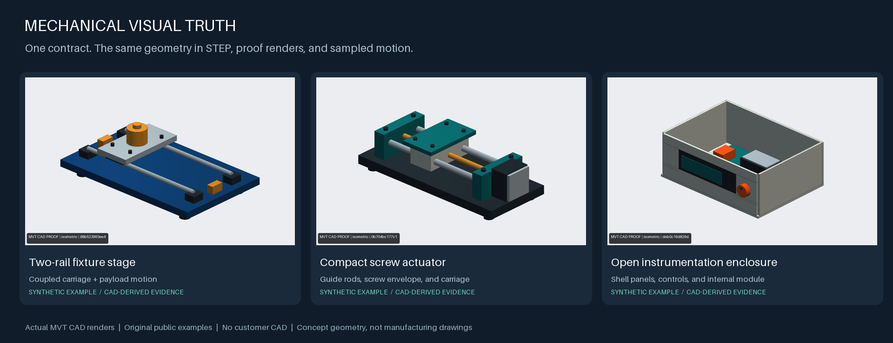

# Mechanical Visual Truth

**Project-independent mechanical CAD, STEP verification, proof rendering and MCP tools.**

One declarative YAML contract drives real CadQuery/Open CASCADE solids, STEP
export, native technical drawings, VTK proof renders, sampled animation and
audits. Use the command line, Python API, or a local stdio MCP client.



**[Explore the drawings, renders, STEP downloads and motion proof →](docs/GALLERY.md)**

## Install

Python 3.12 is the supported runtime. A fresh virtual environment is recommended.

```bash
git clone https://github.com/ufukefekaya-tr/mechanical-visual-truth.git
cd mechanical-visual-truth
python3.12 -m venv .venv
.venv/bin/python -m pip install -e '.[dev]'
.venv/bin/mvt doctor
```

VTK uses offscreen rendering. On Linux, install the platform's OpenGL/EGL
runtime; an Xvfb session is another option on hosts without a suitable driver.
No cloud account or model API key is required.

## Start any project

```bash
mvt project init ./my-assembly --template fixture-stage
mvt contract validate ./my-assembly
mvt build ./my-assembly
mvt render ./my-assembly --set proofs
mvt audit ./my-assembly
mvt animate build ./my-assembly --sequence shuttle
```

Available templates: `fixture-stage`, `linear-actuator`, `instrument-enclosure`.
They are original synthetic examples, with no customer models or vendor CAD.
Paths are explicit; projects can live outside this source checkout.

Edit the contract to define entities, dimensions, materials, cameras and audit
requirements. Primitive geometry and hash-locked local STEP/BREP sources can
share one entity registry. A source belongs to its contract directory; it is
never discovered through another project, a global library or a server path.

```bash
# Preview geometry before producing a STEP deliverable:
mvt build ./my-assembly --no-step

# Inspect any STEP, or create a true vector projection drawing:
mvt step inspect ./part.step --json
mvt step drawing ./part.step ./part-drawing.svg --title 'Example part'
```

The drawing contains orthographic projections and overall dimensions in mm.
It is not a GD&T, tolerance, material or manufacturing approval package.

## MCP

Start a workspace-scoped server with the official Python MCP SDK:

```bash
mvt-mcp --workspace /absolute/path/to/workspace
```

Example MCP host configuration (replace the two paths):

```json
{
  "mcpServers": {
    "mechanical-visual-truth": {
      "command": "/absolute/path/to/.venv/bin/mvt-mcp",
      "args": ["--workspace", "/absolute/path/to/workspace"]
    }
  }
}
```

The tools create/read/update contracts, validate, build, render, audit, animate,
inspect STEP, draw SVG and list artifacts. Inputs use workspace-relative paths.
CAD workers are serialized and time bounded. Existing contract updates require
their current hash. There is no shell, arbitrary-code, publish or automatic
acceptance tool. See [MCP tools and boundaries](docs/MCP.md).

## What an audit proves

- Actual B-rep geometry, declared counts, placements, envelope and constraints.
- Independent STEP reload with solid inventory, validity, volume, bounds and
  geometry comparisons.
- Contract/model/source hashes connecting geometry, images and generated runs.
- Sampled motion checks only for the actors, pairs and times explicitly declared.

Concept visualization, geometric verification and physical/safety qualification
are separate. A geometry PASS does not certify a mechanism, motor, load capacity,
manufacturing drawing or safe machine. Presentation-only imagery never becomes
the geometric master. Missing or deferred checks remain visible.

## Reproduce and extend

```bash
pytest
python scripts/generate_gallery.py
python -m build
```

The gallery generator uses temporary copies of the bundled contracts and records
artifact hashes. Development lessons recovered from later STEP-producing tools
are described in [Upstreamed improvements](docs/UPSTREAMING.md). Customer parts,
private project state and old Git history are excluded from this public tree.

Optional workspace governance includes a local index, acceptance ledger, compact
handoffs and reversible rules. It is not required for CAD or MCP use. See
[operations](docs/OPERATIONS.md), [animation](docs/ANIMATION.md), and the
[repository skills](skills/mechanical-visual-truth/SKILL.md).

## License and authorship

Copyright **2026 Ufuk Efe Kaya**.

Original source, documentation, synthetic example geometry and generated example
media are dual licensed under **MIT OR Apache-2.0**, at your option. See
[LICENSE](LICENSE), [LICENSE-MIT](LICENSE-MIT), [LICENSE-APACHE](LICENSE-APACHE)
and [NOTICE](NOTICE). Dependencies retain their own licenses.
