# Gallery

These are actual CAD proof renders produced by MVT from the synthetic contracts in [`examples/`](../examples/). The same entity geometry drives the STEP downloads, orthographic proofs, and sampled animation. SVG drawings are native hidden-line projections from the exported STEP geometry. The examples were created from scratch for this public repository; no customer CAD, previous project dimensions, commercial render assets, or private project identifiers were imported.


## Two-rail fixture stage

A blue base, two guide rails, and a carriage carrying a brass demonstration payload. The shuttle sequence moves the carriage, bearing carriers, fasteners, and payload as a single coupled group.

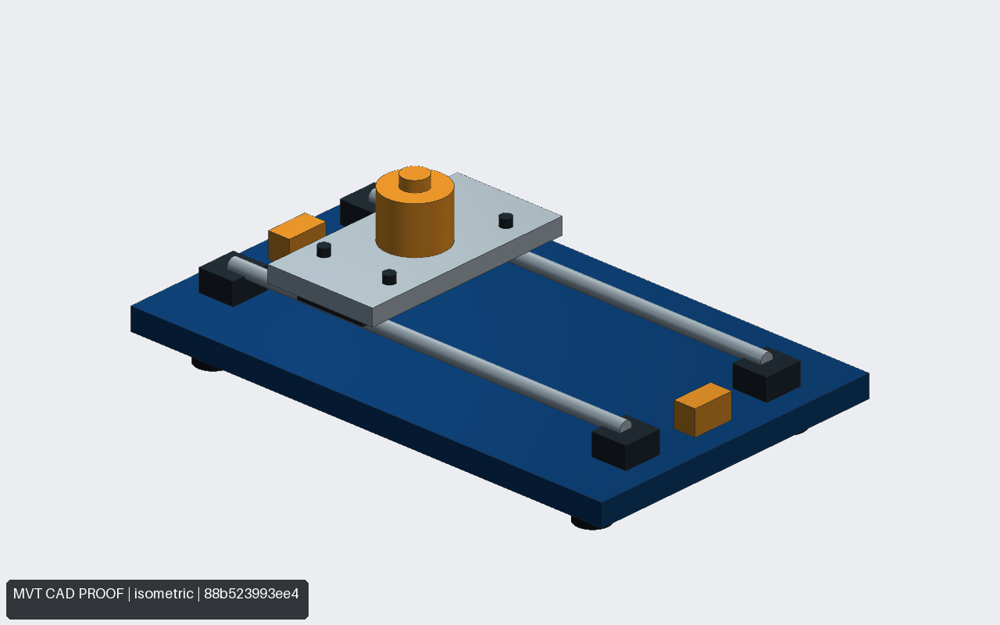

| Top orthographic proof | Front orthographic proof |
| --- | --- |
| 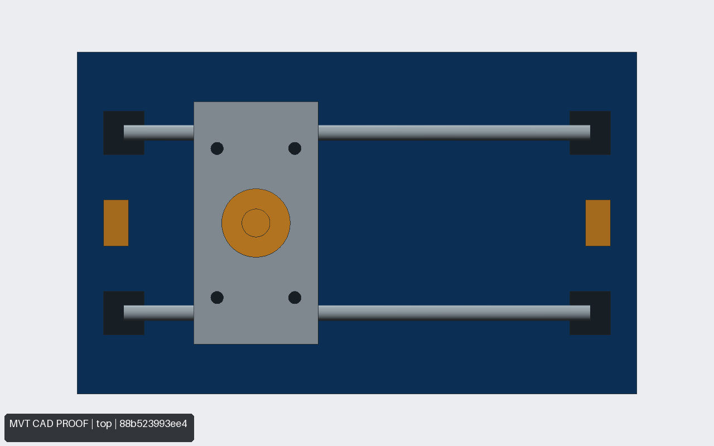 | 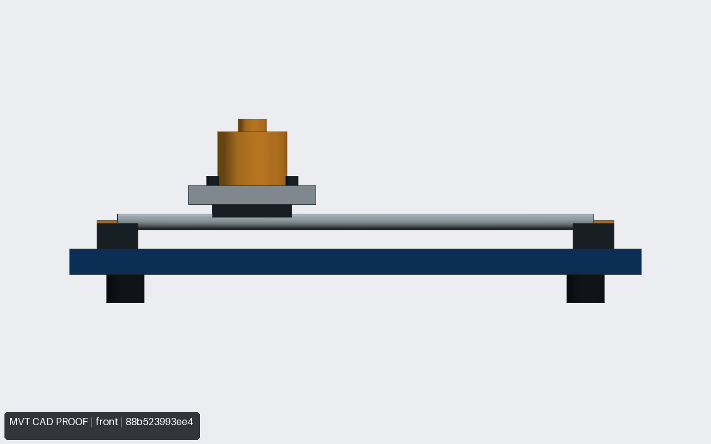 |

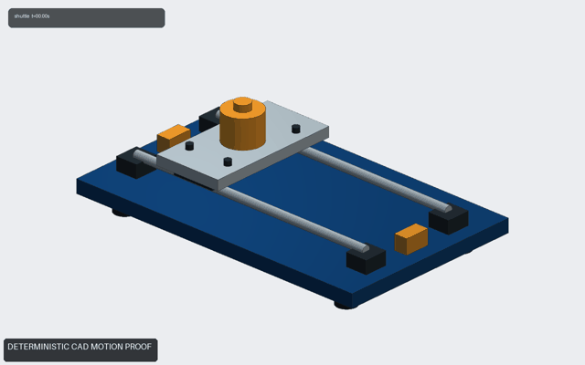

[Geometry contract](../examples/fixture-stage/contract.yaml) · [STEP assembly](assets/fixture-stage/fixture-stage.step) · [MP4 motion proof](assets/fixture-stage/shuttle.mp4) · [Six sampled frames](assets/fixture-stage/shuttle_contact_sheet.jpg) · [Geometry audit](assets/fixture-stage/audit.json) · [Motion manifest](assets/fixture-stage/animation-manifest.json)

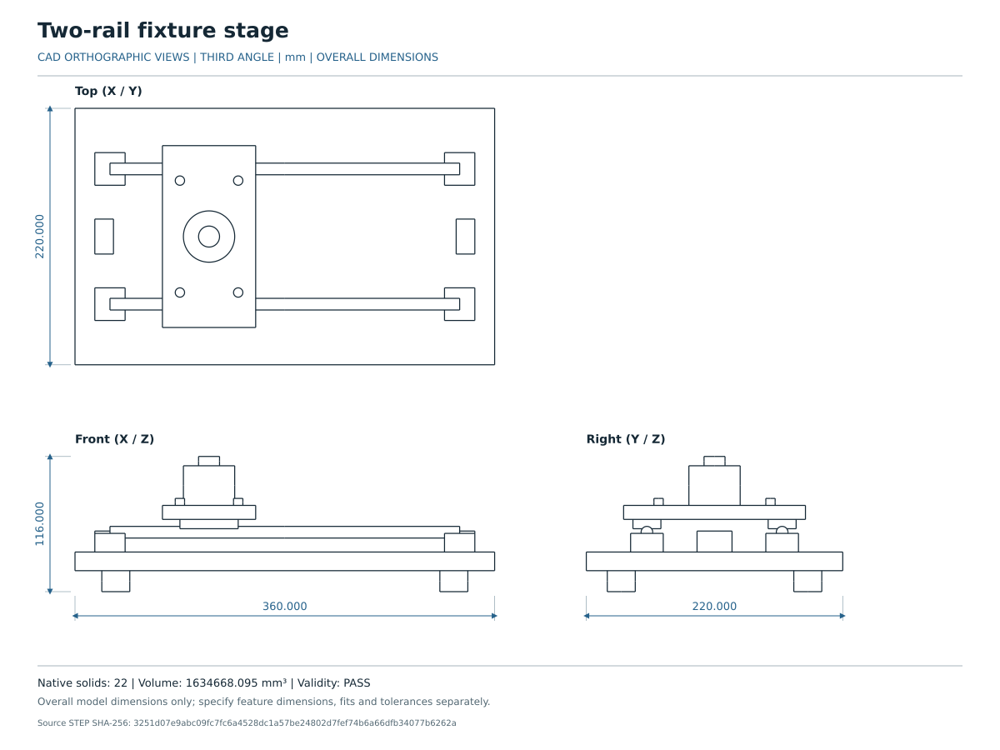

## Compact screw actuator

A dark bed, teal end supports, two steel guide rods, a gold screw envelope, and a contrasting carriage. The screw is a simple cylinder; the motor is a generic envelope with no vendor claim.

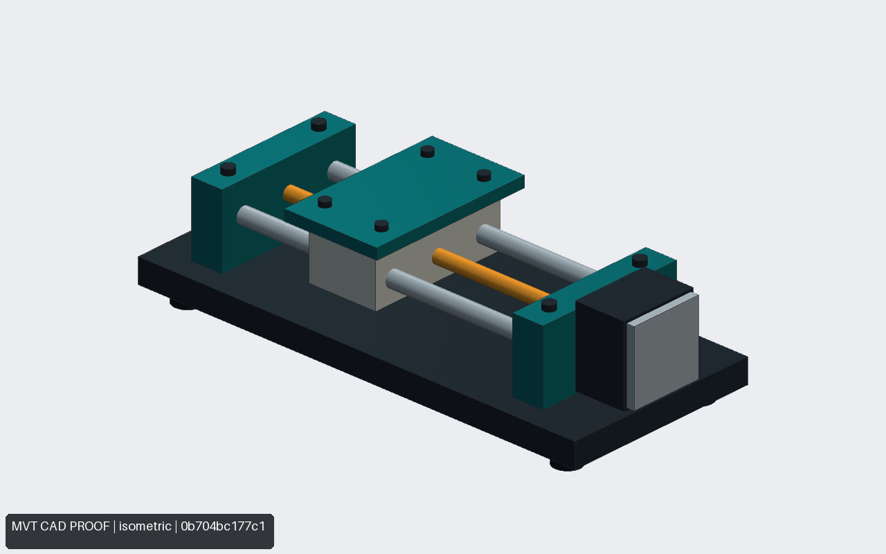

| Top orthographic proof | Front orthographic proof |
| --- | --- |
| 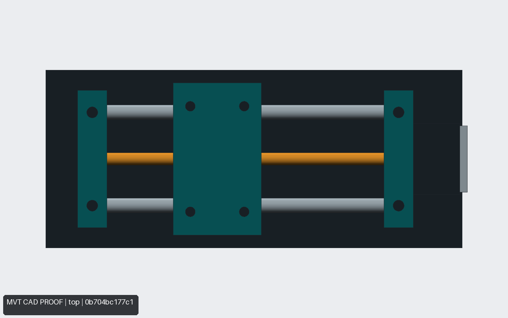 | 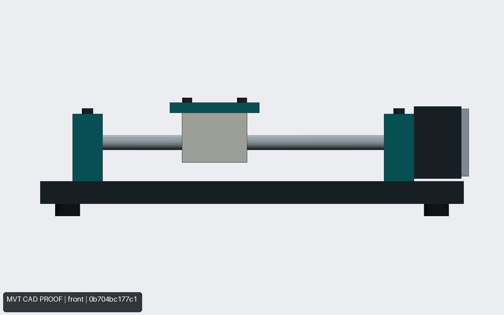 |

[Geometry contract](../examples/linear-actuator/contract.yaml) · [STEP assembly](assets/linear-actuator/linear-actuator.step) · [Geometry audit](assets/linear-actuator/audit.json)

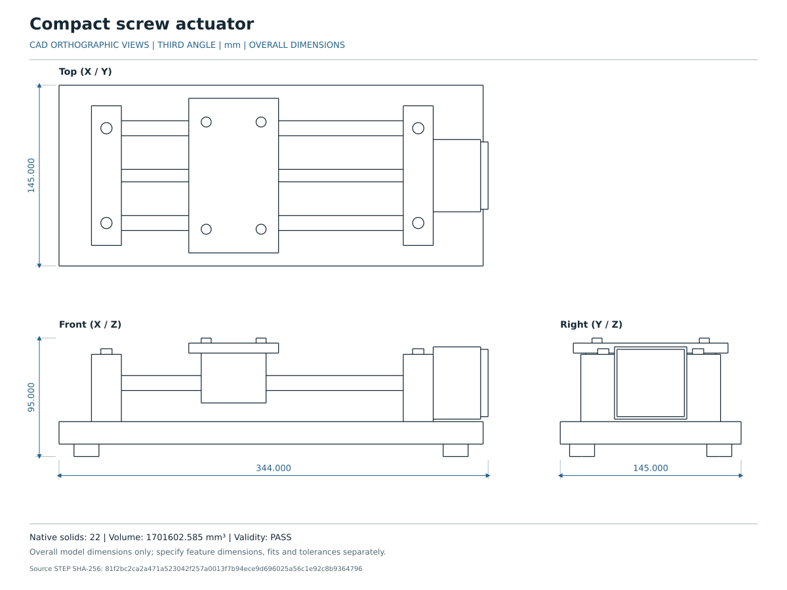

## Open instrumentation enclosure

An open enclosure with panelled front, display and knob proxies, board standoffs, and a small internal module. Every visible solid is directly declared in the contract.

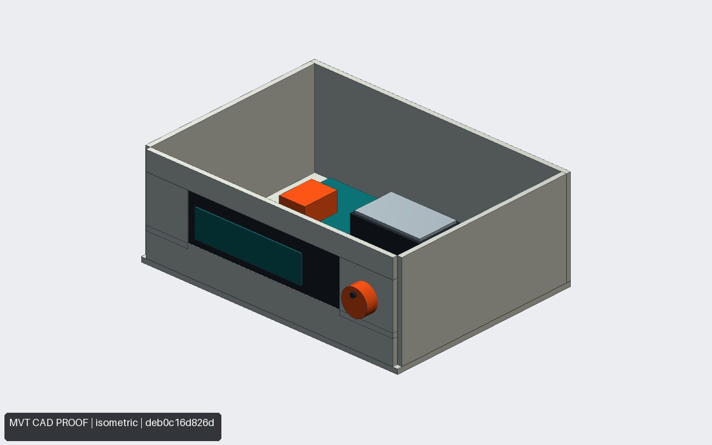

| Top orthographic proof | Front orthographic proof |
| --- | --- |
| 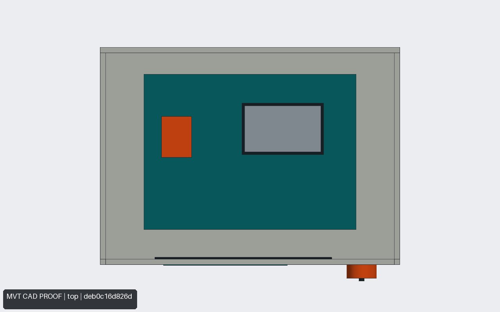 | 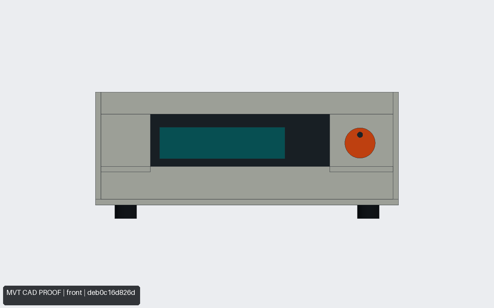 |

[Geometry contract](../examples/instrument-enclosure/contract.yaml) · [STEP assembly](assets/instrument-enclosure/instrument-enclosure.step) · [Geometry audit](assets/instrument-enclosure/audit.json)

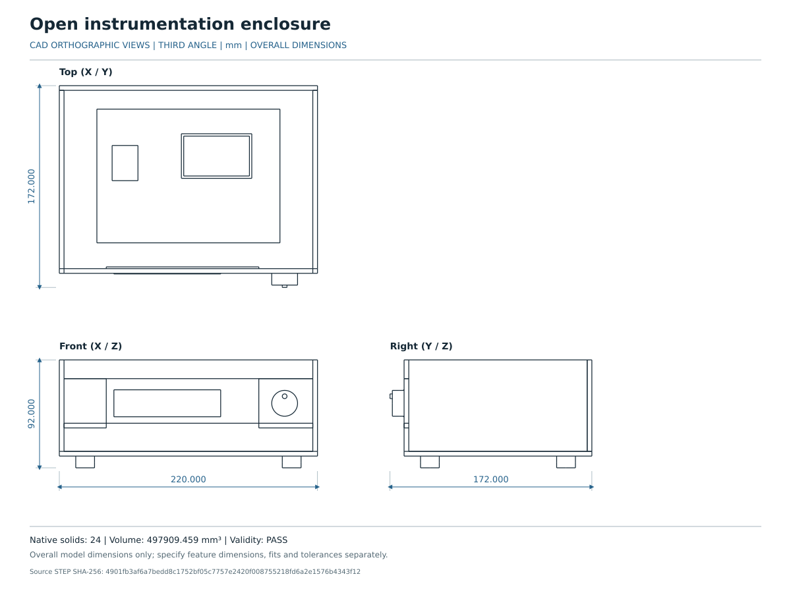

## Reproduce and verify

With MVT's CAD dependencies installed, run this command at the repository root:

```bash
python scripts/generate_gallery.py
```

The script validates each bundled contract, builds and independently reloads its STEP assembly, renders every declared proof camera, extracts top/front/right SVG drawing views from STEP, runs geometry audits, and builds the fixture-stage motion proof. The STEP reload verification compares the actual exported geometry to the contract-built source solids. Temporary run directories stay outside the source tree. The published [gallery manifest](assets/gallery-manifest.json) records contract/model hashes, software versions, artifact sizes, and SHA-256 hashes with repository-relative paths.

Geometry audits cover entity counts, the declared envelope, and explicit clearances. The animation audit covers declared pairs and coupling at sampled states. These simplified primitive assemblies do not represent bores, threads, fits, forces, load ratings, bend allowances, or manufacturing certification. Proof renders are derived from CAD without image generation or geometry retouching.

Copyright Ufuk Efe Kaya. Example contracts, generated CAD, proof images, and gallery documentation are available under **MIT OR Apache-2.0**, like the repository. See the license files at the repository root.
